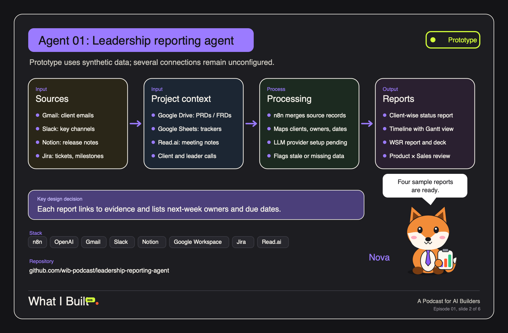

# Leadership Reporting Agent

> **From the What I Built (WIB) podcast, Episode 01 (Agent 01).** A Podcast for AI Builders.

An n8n workflow that turns a product manager's scattered project signals into
leadership-ready status reports. It saves me roughly 10 to 15 hours a week of
building weekly and recurring leadership reports by hand.

**Live sample reports:** https://wib-leadership-reporting-agent.vercel.app

## Input

- **Gmail**: client threads, timelines and commitments
- **Slack**: key channel messages and announcements
- **Notion**: release notes
- **Google Drive**: PRDs and client-facing FRDs
- **Google Sheets**: project and program trackers
- **Jira**: delivery tickets and milestones
- **Meeting notes** (Read.ai, or any transcription API): client and leadership calls

## Process

1. **Trigger**: a manual run, or a weekly schedule (Monday 09:00, shipped switched off).
2. **Reporting window**: picks the last 7 days and passes the dates to every source.
3. **Pull sources**: seven connector nodes run in parallel. A source that fails or isn't connected is skipped instead of stopping the run.
4. **Normalize**: every item becomes one evidence record:
   `source, source_id, client, project, owner, observed_at, due_date, status, summary, evidence_url`.
5. **LLM synthesis**: an n8n AI Agent node (OpenAI by default; Claude Haiku works too) returns strict JSON: client health, milestones, releases, decisions needed and data gaps, each citing source records.
6. **Quality gate**: drops any claim whose evidence doesn't match a real source record (no hallucinated status), and flags stale evidence (older than 14 days) and missing owners or dates.
7. **Reports**: four nodes render branded HTML, each attached as a file to send onward.

## Output

- **Client-wise status report**: health, progress, blockers, next step and owner per client
- **Timeline-wise status report**: cross-project Gantt with today marked, plus a milestone ledger
- **Weekly status review (WSR)**: what needs leadership attention, decisions and asks, deck outline
- **Product × Sales connect**: shipped / ready / in progress / blocked funnel, readiness by account, agenda

Every report lists its evidence and a "Gaps & checks" box, so nothing missing is hidden.

## What's in this repo

| Path | What it is |
|---|---|
| `workflow/leadership-reporting-architecture.json` | **The agent.** Import into n8n, add credentials, run. |
| `workflow/leadership-reporting-showcase.json` | No-credentials demo: mock records in, two reports out. Run it first. |
| `site/` | The static sample-report site deployed on Vercel |
| `reports/specimens/` | Four 5-page PDF report specimens (client, timeline/Gantt, WSR, Product × Sales) |
| `reports/build_specimens.py` + `specimen-data.json` | Regenerates the PDFs from the synthetic fixture (`pip install reportlab`) |
| `scripts/start-local-n8n.sh` | Runs the free n8n Community Edition locally |

## Setup

1. **Run n8n** (free, local): `./scripts/start-local-n8n.sh` and open http://127.0.0.1:5678.
   Or use n8n Cloud, or `docker run -it --rm -p 5678:5678 n8nio/n8n`.
2. **Try the demo**: Workflows → Import from file → `workflow/leadership-reporting-showcase.json` → Execute workflow. Open the output of *Build two reports*.
3. **Import the agent**: import `workflow/leadership-reporting-architecture.json`.
4. **Add credentials** on each source node you use (Gmail, Slack, Notion, Google Drive, Google Sheets, Jira). Pick the Notion database and the Sheet in their nodes. For meeting notes, point the HTTP node at your provider's API and add its key as a header credential.
5. **Add the model**: open *OpenAI Chat Model*, add your API key. To use Claude instead, swap it for the *Anthropic Chat Model* node (e.g. Claude Haiku) and connect it to the agent.
6. Optional: list your client names in `CLIENTS` at the top of the *Normalize* node so records get tagged.
7. **Execute** with the manual trigger. Open any report node and download the `data` binary, or add a Gmail / Slack / Google Drive node after it to send the HTML.
8. When you're happy, enable *Weekly leadership schedule* and activate the workflow.

## Notes

- All names, clients, tickets and numbers in the samples are fictional.
- No credentials ship with this repo. Credential slots in the workflow are empty placeholders.
- Your data goes to whichever LLM provider you connect. Check that's allowed before you point it at work email.
